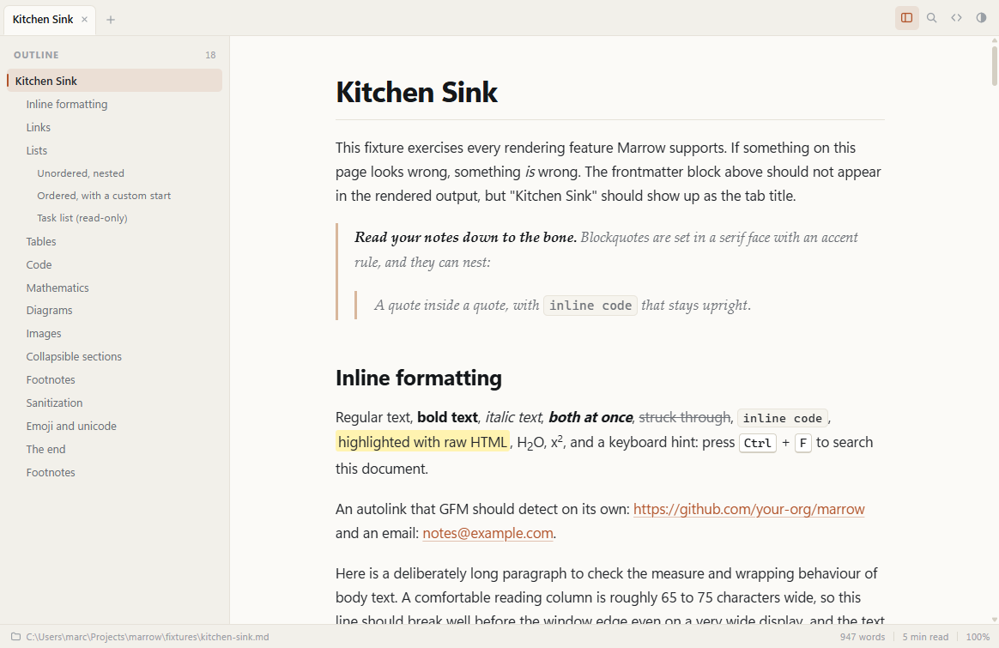
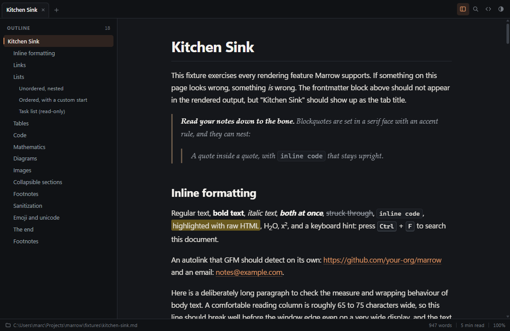
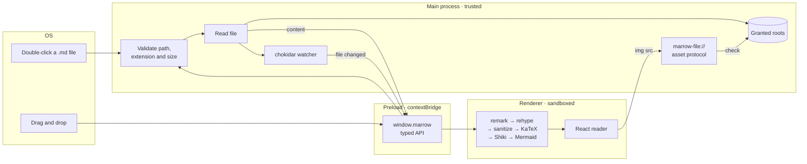

<div align="center">


# Marrow

**Read your notes down to the bone.**

A fast, quiet desktop Markdown viewer for macOS and Windows. Not an editor, not
a browser tab — a reader, built for the folder of `.md` files you actually keep.

[Install](#install) · [Shortcuts](#keyboard-shortcuts) · [Architecture](#architecture) · [Contributing](#contributing)

</div>

---

Marrow opens a markdown file the way a good reader should: instantly, with real
typography, with your code highlighted, your maths typeset, your diagrams drawn,
and your relative links and images working. Save the file in your editor and the
view updates without losing your place.

It renders GitHub Flavored Markdown through a sanitized
[unified](https://unifiedjs.com/) pipeline, runs the renderer sandboxed with a
strict Content-Security-Policy, and never gives the page a filesystem.

## Screenshots

| Light                                              | Dark                                             |
| -------------------------------------------------- | ------------------------------------------------ |
|  |  |

> These are generated by the end-to-end suite. `npm run test:e2e` writes fresh
> ones to `test-results/kitchen-sink-{light,dark}.png`.

## Features

**Reading**

- Full GitHub Flavored Markdown: tables, task lists, strikethrough, autolinks
  and footnotes
- Syntax highlighting for every language [Shiki](https://shiki.style) bundles,
  with a language label and a copy button on each block
- Maths with [KaTeX](https://katex.org), inline (`$…$`) and display (`$$…$$`)
- [Mermaid](https://mermaid.js.org) diagrams from ` ```mermaid ` blocks, tinted
  to match the app theme and redrawn when it changes; a diagram that will not
  parse gets a friendly inline error box instead of taking the page down
- YAML frontmatter is hidden, and its `title` names the tab
- A typographic stylesheet built for long reading: a 72-character measure, a
  real heading scale, serif blockquotes, striped scrollable tables

**Getting files in**

- File ▸ Open, drag-and-drop anywhere on the window, or "Open with Marrow" from
  Finder and Explorer
- Registered for `.md`, `.markdown`, `.mdown` and `.mkd`
- Accepts a path when launched from a terminal or a script, e.g.
  `"%LOCALAPPDATA%\Programs\Marrow\Marrow.exe" notes.md` or
  `open -a Marrow notes.md` (Marrow does not install a `marrow` shim on `PATH`)
- Files the OS hands over before the window is ready are queued, not dropped
- Recent files, persisted and capped at ten, in the menu and on the start screen

**Moving around**

- Collapsible outline sidebar that tracks the heading you are reading
- Find in document with a live match count and next/previous, scoped to the
  document so the sidebar and tab labels never inflate the count
- Tabs, with `Ctrl+Tab` cycling and middle-click to close
- Relative links to other markdown files open in a tab; everything else opens in
  your browser or the OS handler
- Heading anchors, smooth scrolling to `#fragments`, and per-file scroll
  positions for the session

**Everything else**

- Live reload on save, without losing your scroll position
- Light, dark and follow-system themes, persisted
- Export to standalone HTML (styles, web fonts and images inlined) or PDF, and
  print from the live window
- Raw markdown source view with highlighting
- Word count and reading time in the status bar
- Native menus on both platforms with every shortcut shown
- Remembered window size and position

## Install

Marrow ships **unsigned**, because code-signing certificates cost money and this
is a free app. Both operating systems will therefore ask you to confirm once.
([Signing is wired up](#code-signing-and-notarization) if you want to build your
own signed copy.)

### macOS

1. Download `Marrow-<version>-universal.dmg` from the
   [latest release](https://github.com/your-org/marrow/releases/latest).
   One build runs natively on both Apple silicon and Intel.
2. Open the dmg and drag **Marrow** to Applications.
3. The first launch will say _"Marrow is damaged and can't be opened"_ or
   _"cannot be opened because the developer cannot be verified"_. That is
   Gatekeeper reacting to the missing signature, not a broken download. Clear the
   quarantine flag:

   ```bash
   xattr -dr com.apple.quarantine /Applications/Marrow.app
   ```

   Then open it normally. Alternatively, right-click the app ▸ **Open** ▸
   **Open**, or allow it under System Settings ▸ Privacy & Security after the
   first blocked attempt.

### Windows

1. Download `Marrow-Setup-<version>.exe` (runs on x64 and arm64) or the smaller
   per-architecture build from the
   [latest release](https://github.com/your-org/marrow/releases/latest).
2. Run it. SmartScreen will show _"Windows protected your PC"_ — click
   **More info**, then **Run anyway**.
3. The installer is **per-user**: no administrator prompt, and it installs to
   `%LOCALAPPDATA%\Programs\Marrow`. The desktop shortcut is optional and off by
   default; a Start Menu entry is always created.

Prefer not to install? `Marrow-<version>-portable.exe` is a single executable
that runs from anywhere — though file associations only come with the installer.

### Setting Marrow as the default viewer

- **macOS** — right-click a `.md` file ▸ Get Info ▸ Open with ▸ Marrow ▸
  Change All.
- **Windows** — right-click a `.md` file ▸ Open with ▸ Choose another app ▸
  Marrow ▸ Always.

## Development

### Prerequisites

- **Node.js 20.19+** (22 LTS recommended — CI builds on 22)
- **npm 10+**
- Platform build tools are only needed for packaging: Xcode command line tools
  on macOS, nothing extra on Windows

### Setup

```bash
git clone https://github.com/your-org/marrow.git
cd marrow
npm install
npm run dev
```

`npm run dev` starts the Vite dev server for the renderer, builds main and
preload, and launches Electron with hot module replacement. It opens on the
start screen; pass a file to open it immediately (the doubled `--` is npm
handing the argument to electron-vite, which hands it to Electron):

```bash
npm run dev -- -- fixtures/kitchen-sink.md
```

Renderer warnings and errors are forwarded to the terminal in development, so
you do not need DevTools open to notice a problem. View ▸ Toggle Developer Tools
is there in development builds when you do want them.

### Scripts

| Script                          | What it does                                         |
| ------------------------------- | ---------------------------------------------------- |
| `npm run dev`                   | Dev server + Electron with HMR                       |
| `npm run build`                 | Build main, preload and renderer into `out/`         |
| `npm start`                     | Preview the production build without packaging       |
| `npm run typecheck`             | `tsc --noEmit` across the three TS projects          |
| `npm run lint`                  | ESLint (type-aware) over everything                  |
| `npm run format`                | Prettier write; `format:check` in CI                 |
| `npm test`                      | Vitest unit tests for the markdown pipeline          |
| `npm run test:e2e`              | Build, then the Playwright Electron suite            |
| `npm run dist`                  | Package for the current platform into `dist/`        |
| `npm run dist:mac` / `dist:win` | Package for one platform                             |
| `npm run dist:dir`              | Unpacked build only — fastest way to check packaging |
| `npm run icons`                 | Regenerate the app icons from `build/icon.svg`       |

### Tests

The markdown pipeline lives in `src/shared/markdown` and has no Electron or DOM
dependency, so it is tested directly with Vitest: GFM features, frontmatter,
maths, Mermaid block detection, relative link and image resolution, sanitization,
and the word-count rules.

The Playwright suite launches the real app, each test with a throwaway
`--user-data-dir`, and asserts on rendered output rather than on screenshots. It
also captures the renderer console and fails if anything logged a warning — which
is how "no Electron security warnings" stays true over time.

```bash
npm test             # unit, ~1s
npm run test:e2e     # builds, then launches Electron ~8 times
```

## Building installers

```bash
npm run dist         # current platform
npm run dist:mac     # dmg + zip, universal (arm64 + x64)
npm run dist:win     # NSIS installers + portable exes, x64 + arm64
```

Artifacts land in `dist/`. On Windows you get three installers — a combined
x64+arm64 one plus one per architecture — and the matching portable executables.

### Cross-building

**Build each platform on that platform.** Use the
[release workflow](#releasing) rather than cross-building locally:

- **Windows from macOS/Linux** is not recommended. electron-builder needs Wine
  to run NSIS and to stamp icons and version metadata into the executables, and
  that path is fragile, slow, and silently produces installers with missing
  resources. Signing is impossible without a Windows code-signing toolchain.
- **macOS from anywhere else** is not possible at all for a usable build: the
  dmg, the universal binary merge and any form of signing or notarization all
  need macOS tooling.
- **Linux AppImage** builds fine on Linux and is included as a convenience
  target; it is not a supported platform.

## Keyboard shortcuts

`Mod` is `Cmd` on macOS and `Ctrl` on Windows. Every one of these is also a menu
item, with the binding shown next to it.

| Action                     | Shortcut                                                                      |
| -------------------------- | ----------------------------------------------------------------------------- |
| Open file                  | `Mod+O`                                                                       |
| New window                 | `Mod+Shift+N`                                                                 |
| Close tab                  | `Mod+W`                                                                       |
| Next / previous tab        | `Ctrl+Tab` / `Ctrl+Shift+Tab`                                                 |
| Reload document from disk  | `Mod+R`                                                                       |
| Find in document           | `Mod+F`                                                                       |
| Find next / previous       | `Mod+G` / `Mod+Shift+G`, or `Enter` / `Shift+Enter`                           |
| Toggle outline sidebar     | `Mod+B`                                                                       |
| Toggle markdown source     | `Mod+U`                                                                       |
| Zoom in / out              | `Mod+Plus` / `Mod+-`                                                          |
| Actual size                | `Mod+0`                                                                       |
| Top / end of document      | `Mod+Up` / `Mod+Down`                                                         |
| Copy document text         | `Mod+Shift+C`                                                                 |
| Export as HTML             | `Mod+Shift+E`                                                                 |
| Export as PDF              | `Mod+Shift+P`                                                                 |
| Print                      | `Mod+P`                                                                       |
| Keyboard shortcuts overlay | `Mod+/`                                                                       |
| Close window               | `Mod+Shift+W` (macOS: `Mod+W` on the last tab closes the tab, not the window) |

Tab cycling uses `Ctrl+Tab` on **both** platforms: `Cmd+Tab` belongs to macOS
and cannot be rebound by an app. macOS also gets `Cmd+Shift+[` / `Cmd+Shift+]`.

## Architecture

```
src/
├── main/          Electron main process (Node, trusted)
│   ├── index.ts        lifecycle, single instance, CLI args, open-file events
│   ├── windows.ts      window creation, bounds, the pre-ready file queue
│   ├── menu.ts         native menus for both platforms
│   ├── ipc.ts          every IPC handler, with validation
│   ├── fileAccess.ts   the only filesystem reads, and the granted-roots gate
│   ├── protocol.ts     marrow:// and marrow-file:// schemes, CSP, session
│   ├── watcher.ts      chokidar watchers, one per (window, file)
│   ├── export.ts       save dialogs and the offscreen PDF renderer
│   └── store.ts        validated JSON state (settings, recents, bounds)
├── preload/       the contextBridge surface, and nothing else
├── renderer/      React UI (sandboxed, no Node)
│   └── src/
│       ├── components/  reader, tabs, outline, find, status bar, empty state
│       ├── state/       documents reducer, bootstrap handshake, theme context
│       ├── lib/         mermaid, find highlighting, export, scroll memory
│       └── styles/      design tokens, base, prose, print
└── shared/        types, path helpers, and the markdown pipeline
    └── markdown/  unified pipeline — no Electron, no DOM, directly testable
```



### The markdown pipeline

`src/shared/markdown/index.ts` is one `unified` processor, and the plugin order
is load-bearing:

```
remark-parse
  → remark-frontmatter   (+ pull out `title`, drop the block)
  → remark-gfm           tables, task lists, strikethrough, autolinks, footnotes
  → remark-math
  → remark-rehype        (raw HTML kept)
  → rehype-raw           parse the HTML that was embedded in the markdown
  → rehype-sanitize      ← everything untrusted is scrubbed here
  → rehype-katex
  → rehype-slug
  → (collect the outline)
  → rehype-autolink-headings
  → (wrap tables for scrolling)
  → (resolve relative links and images)
  → Shiki, and mermaid blocks become <marrow-mermaid>
```

Sanitizing **before** the trusted generators run is the important decision: the
schema never has to be loose enough to permit MathML, Shiki's inline styles or
SVG, because that markup is added afterwards. (The schema permits them anyway, so
the step can be moved to the end without quietly breaking those features.)

The result is a [hast](https://github.com/syntax-tree/hast) tree, not a string.
The renderer converts it with `hast-util-to-jsx-runtime` and maps two custom
elements — `<marrow-code>` and `<marrow-mermaid>` — onto React components, which
is how code blocks get a copy button and diagrams get rendered without a single
`innerHTML` of untrusted content.

### Security model

| Control                                                              | Where                                            |
| -------------------------------------------------------------------- | ------------------------------------------------ |
| `contextIsolation: true`, `nodeIntegration: false`, `sandbox: true`  | `src/main/windows.ts`                            |
| `webSecurity` never disabled, no `webview`, no popups, no navigation | `src/main/windows.ts`                            |
| Minimal typed API over `contextBridge` — no `ipcRenderer` exposure   | `src/preload/index.ts`                           |
| Every IPC argument validated before use                              | `src/main/ipc.ts`                                |
| Markdown reads limited to known extensions and a 32 MB ceiling       | `src/main/fileAccess.ts`                         |
| Assets served only from folders the user opened ("granted roots")    | `src/main/fileAccess.ts`, `src/main/protocol.ts` |
| HTML sanitized with `rehype-sanitize`                                | `src/shared/markdown/sanitize.ts`                |
| Strict CSP served with the app, permission requests denied           | `src/main/protocol.ts`                           |

A few consequences worth knowing:

- The renderer is served from **`marrow://app`**, not `file://`. A real origin is
  what makes `'self'` in the CSP mean anything, and it keeps `file://` quirks out
  of the app.
- Images are rewritten to `marrow-file://local/<base64url of the path>`. Main
  decodes the token, checks the extension against an image/media allowlist,
  checks the path against the granted roots, and only then streams bytes. The
  renderer never receives a path it can act on.
- `style-src` needs `'unsafe-inline'`: Mermaid puts a `<style>` element in every
  diagram, and Shiki and KaTeX set inline `style` attributes. `script-src` stays
  at `'self'`.
- **No `eval`, and no `wasm-unsafe-eval`.** Shiki runs on its JavaScript RegExp
  engine rather than the default Oniguruma WebAssembly engine, which keeps the
  policy tight and removes a wasm fetch from startup.
- Clobber prefixing is disabled in the sanitizer. `remark-rehype` already
  prefixes footnote ids with `user-content-` and keeps their hrefs in sync;
  re-prefixing would break every footnote link, and a locally viewed document has
  no surrounding page whose ids could be shadowed.

### Other decisions worth knowing

- **Zoom scales the document, not the window.** `Mod+Plus` changes a CSS
  variable on the article instead of `webContents.setZoomFactor`, so the tab
  strip, outline and status bar stay crisp at their intended size.
- **Find uses the CSS Custom Highlight API**, not `webContents.findInPage`. The
  native search would also match the outline and the tab labels, which makes the
  count wrong for a reader; walking the article's own text nodes gives an exact
  count and highlights every hit without mutating the rendered tree.
- **Export serializes the live DOM.** Mermaid diagrams are already inline SVG and
  Shiki tokens already carry their colours, so the exported file is exactly what
  you were looking at. Stylesheets are read back out of `document.styleSheets`
  and their web fonts and your images are inlined as data URIs, so a single HTML
  file works offline with no asset folder beside it.
- **PDFs are always light.** A PDF is a printed artefact, so it uses the light
  palette whatever the app theme is — including re-rendering diagrams, which bake
  their colours into the SVG.
- **Styling is CSS Modules plus a global token layer.** Components get scoped
  classes; the prose stylesheet and the design tokens are global, because the
  exported HTML has to be able to reuse them verbatim.
- **Every dependency is bundled.** `dependencies` in `package.json` is empty and
  everything is a devDependency that electron-vite inlines into `out/`, so the
  packaged app ships no `node_modules` at all.
- **All of Shiki's grammars are available.** They are emitted as lazy chunks and
  loaded the first time a document uses them, which costs disk space in the
  installer but means every language a note might contain gets highlighted.
- **Task list checkboxes are read-only.** Marrow is a viewer; it never writes to
  your files.

## Code signing and notarization

Nothing below is needed to build or run Marrow. Signing is entirely driven by
environment variables, and electron-builder skips it when they are absent — which
is what the default unsigned build does.

### macOS

You need an Apple Developer account and a **Developer ID Application**
certificate exported as a `.p12`.

```bash
# Base64-encode the certificate so it can live in a secret
base64 -i DeveloperID.p12 | pbcopy

export CSC_LINK="<base64 of the .p12, or a file path/URL>"
export CSC_KEY_PASSWORD="<password you set when exporting>"

# Notarization — all three are required, or it is skipped
export APPLE_ID="you@example.com"
export APPLE_APP_SPECIFIC_PASSWORD="abcd-efgh-ijkl-mnop"   # appleid.apple.com
export APPLE_TEAM_ID="XXXXXXXXXX"                          # 10-character team id

npm run dist:mac
```

`build/entitlements.mac.plist` grants only what Electron needs (JIT) plus
read-only access to user-selected files. The hardened runtime is already enabled
in `electron-builder.yml`, which notarization requires.

Check the result:

```bash
codesign -dv --verbose=4 dist/mac-universal/Marrow.app
spctl -a -vvv -t install dist/mac-universal/Marrow.app
xcrun stapler validate dist/Marrow-0.1.0-universal.dmg
```

### Windows

You need an Authenticode certificate. EV certificates on a hardware token cannot
be used in CI; a standard OV certificate as a `.p12` can.

```powershell
$env:WIN_CSC_LINK = "<base64 of the .p12, or a path>"
$env:WIN_CSC_KEY_PASSWORD = "<password>"
npm run dist:win
```

Signing removes the SmartScreen warning only once the certificate has built up
reputation; a brand new certificate will still warn for a while.

### In CI

`release.yml` already reads all of these from repository secrets
(`CSC_LINK`, `CSC_KEY_PASSWORD`, `APPLE_ID`, `APPLE_APP_SPECIFIC_PASSWORD`,
`APPLE_TEAM_ID`, `WIN_CSC_LINK`, `WIN_CSC_KEY_PASSWORD`). Add the secrets and the
next tagged build is signed; leave them unset and it is not.

## Releasing

1. Update `CHANGELOG.md` and bump the version:

   ```bash
   npm version minor      # or patch / major — this creates the commit and tag
   ```

2. Push the tag:

   ```bash
   git push --follow-tags
   ```

3. `release.yml` builds on `macos-latest` and `windows-latest`, uploads the
   installers, and opens a **draft** GitHub Release with generated notes.
4. Check the artifacts, then publish the draft.

`workflow_dispatch` on the same workflow can rebuild an existing tag without
pushing a new one.

## Replacing the app icon

`build/icon.svg` is the single source. Edit it, then:

```bash
npm run icons
```

That rasterizes the SVG with [sharp](https://sharp.pixelplumbing.com) and writes
everything electron-builder needs:

- `build/icon.png` — 1024×1024, used for Linux and as the generic source
- `build/icon.ico` — Windows, 16–256 px
- `build/icon.icns` — macOS, 16–1024 px
- `build/icons/*.png` — individual sizes for stores and docs

The `.ico` and `.icns` containers are assembled in `scripts/generate-icons.mjs`
rather than shelled out to `iconutil` or ImageMagick, so the script works the
same on every platform. The shipped icon is a placeholder — a cross-sectioned
bone — and is meant to be replaced.

## Troubleshooting

**"This file type is not supported"** — Marrow only opens `.md`, `.markdown`,
`.mdown` and `.mkd`. That restriction is part of the security model, not a
display filter.

**An image does not load.** Marrow only serves assets from folders you have
actually opened. An image at `../../elsewhere/pic.png`, outside the opened
document's folder tree, is refused on purpose. Open a document in that folder too
and it will resolve. `fixtures/failure-modes.md` demonstrates both cases.

**A diagram shows an error box.** The Mermaid source did not parse. The box
includes Mermaid's own message and the original text — the surrounding document
is unaffected.

**Live reload does not fire.** Files on network shares and some synced folders do
not emit filesystem events. `Mod+R` re-reads the file from disk.

**The window opens off-screen after moving between monitors.** Saved bounds are
validated against the connected displays on launch and the window is re-centred
if they no longer fit. If it ever gets stuck, delete `marrow-state.json` in:

- macOS: `~/Library/Application Support/Marrow/`
- Windows: `%APPDATA%\Marrow\`

**macOS says the app is damaged.** That is the missing signature. See
[Install ▸ macOS](#macos).

**`npm run dev` fails with `EADDRINUSE`.** Another dev server holds port 5173.
Stop it, or run `npm run dev -- --port 5174`.

**Playwright tests hang on Linux.** Electron needs a display server:
`xvfb-run --auto-servernum npx playwright test`, as CI does.

**Packaging fails on Windows with a locked file.** An earlier Marrow process is
still running. Close it (or `taskkill /im Marrow.exe /f`) and rebuild.

## Contributing

Pull requests are welcome. The short version:

1. Fork, branch from `main`, and keep changes focused.
2. `npm run lint && npm run typecheck && npm test` must pass. CI runs them on
   Linux, macOS and Windows plus the Electron suite, so run `npm run test:e2e`
   locally for anything that touches the main process, the preload API or the
   renderer shell.
3. `npm run format` before committing — Prettier config is in the repo and
   `format:check` runs in CI.
4. Put markdown-pipeline changes in `src/shared/markdown` with a Vitest case
   beside them. Keep that directory free of Electron and DOM imports; that is
   what makes it testable.
5. Never widen the security model casually. `contextIsolation`, `sandbox`,
   `nodeIntegration`, the CSP, the sanitizer schema and the granted-roots check
   are the load-bearing parts — if a feature seems to need one of them relaxed,
   say so in the PR and explain why.
6. Add a `CHANGELOG.md` entry under **Unreleased** for anything a user would
   notice.

Found a bug? Open an issue with your OS, the Marrow version from Help ▸ Keyboard
Shortcuts, and a minimal `.md` file that reproduces it.

## License

[MIT](LICENSE) © Marrow Contributors.

Marrow stands on [Electron](https://www.electronjs.org/),
[unified](https://unifiedjs.com/), [Shiki](https://shiki.style),
[KaTeX](https://katex.org) and [Mermaid](https://mermaid.js.org) — thank you to
everyone who maintains them.
