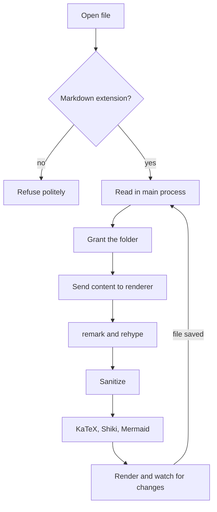
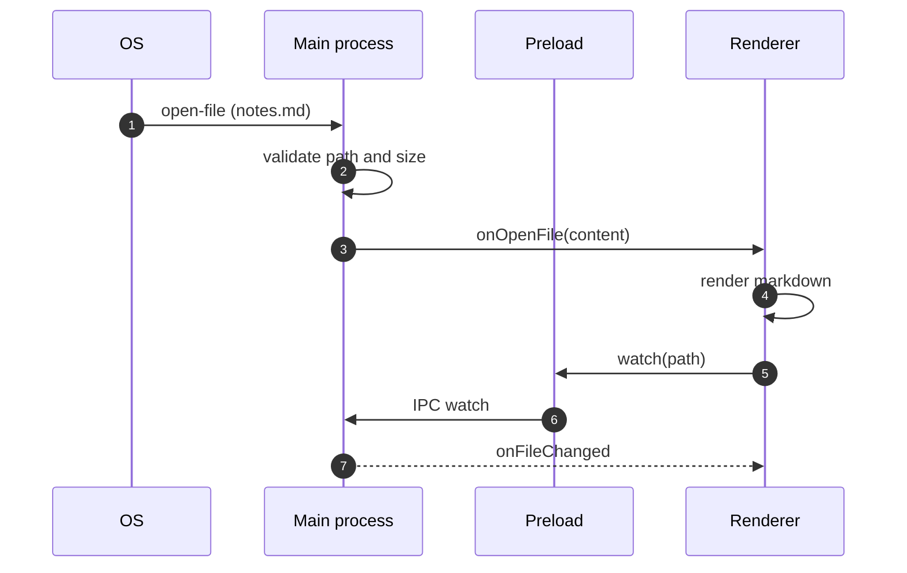
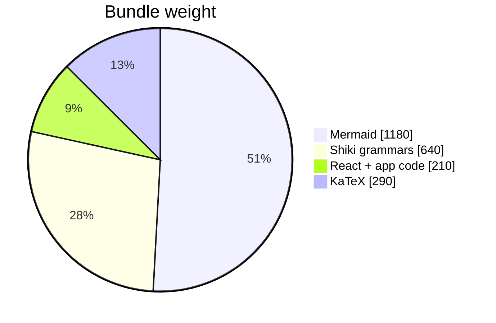
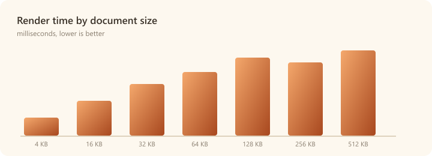

# Kitchen Sink

This fixture exercises every rendering feature Marrow supports. If something on
this page looks wrong, something _is_ wrong. The frontmatter block above should
not appear in the rendered output, but "Kitchen Sink" should show up as the tab
title.

> **Read your notes down to the bone.**
> Blockquotes are set in a serif face with an accent rule, and they can nest:
>
> > A quote inside a quote, with `inline code` that stays upright.

## Inline formatting

Regular text, **bold text**, _italic text_, _**both at once**_, ~~struck
through~~, `inline code`, <mark>highlighted with raw HTML</mark>, H<sub>2</sub>O,
x<sup>2</sup>, and a keyboard hint: press <kbd>Ctrl</kbd> + <kbd>F</kbd> to
search this document.

An autolink that GFM should detect on its own: https://github.com/your-org/marrow
and an email: notes@example.com.

Here is a deliberately long paragraph to check the measure and wrapping
behaviour of body text. A comfortable reading column is roughly 65 to 75
characters wide, so this line should break well before the window edge even on a
very wide display, and the text should stay centred in the reading pane.

---

## Links

- [External link](https://www.electronjs.org/) — opens in the system browser.
- [Relative markdown link](./linked.md) — opens in a new Marrow tab.
- [Relative link with a fragment](./linked.md#deep-section) — opens and scrolls.
- [Anchor within this page](#tables) — smooth-scrolls to the Tables section.
- [A local non-markdown file](./assets/render-times.png) — handed to the OS.

## Lists

### Unordered, nested

- Markdown pipeline
  - remark for parsing
  - rehype for the HTML side
    - and a sanitizer between the two
- Rendering
  - Shiki for code
  - KaTeX for maths
  - Mermaid for diagrams

### Ordered, with a custom start

3. Third item, because the list starts at three.
4. Fourth item.
5. Fifth item.

### Task list (read-only)

- [x] Parse GitHub Flavored Markdown
- [x] Highlight fenced code with Shiki
- [x] Render maths with KaTeX
- [ ] Teach the cat to proofread
- [ ] Achieve inbox zero

## Tables

| Feature          |    Shortcut    | Status | Notes                                    |
| :--------------- | :------------: | -----: | :--------------------------------------- |
| Open file        |  `Ctrl/Cmd+O`  |   Done | Dialog, drag-and-drop, or OS "Open with" |
| Find in document |  `Ctrl/Cmd+F`  |   Done | Scoped to the document, not the chrome   |
| Toggle source    |  `Ctrl/Cmd+U`  |   Done | Highlighted markdown                     |
| Export to PDF    | `Ctrl/Cmd+⇧+P` |   Done | Rendered in an offscreen window          |
| Telepathy        |       —        |   Todo | Blocked on hardware                      |

Wide tables scroll horizontally inside their own container rather than
stretching the reading column:

| id  | created              | author | subsystem | summary                          | duration_ms | allocations | notes                          |
| --- | -------------------- | ------ | --------- | -------------------------------- | ----------- | ----------- | ------------------------------ |
| 1   | 2026-01-04T09:12:00Z | ada    | pipeline  | Parse frontmatter before GFM     | 12          | 1_024       | Keeps the YAML out of the tree |
| 2   | 2026-01-04T09:14:00Z | grace  | sanitize  | Allow MathML through the schema  | 8           | 512         | KaTeX output survives          |
| 3   | 2026-01-04T09:31:00Z | linus  | protocol  | Serve assets over marrow-file:// | 31          | 4_096       | webSecurity stays on           |

## Code

TypeScript, with a language label and a copy button:

```ts
import { renderMarkdown } from '@shared/markdown'

export async function preview(source: string, path: string): Promise<string | null> {
  const { title, stats, toc } = await renderMarkdown(source, { basePath: path })
  console.info(`${title ?? 'untitled'}: ${stats.words} words, ${toc.length} headings`)
  return title
}
```

Python:

```python
from dataclasses import dataclass

@dataclass(frozen=True, slots=True)
class Heading:
    depth: int
    text: str

    def slug(self) -> str:
        return "-".join(self.text.lower().split())

print([Heading(2, "Kitchen Sink").slug()])
```

Rust:

```rust
#[derive(Debug, Clone)]
pub struct Marrow<'a> {
    pub title: &'a str,
    pub words: usize,
}

impl<'a> Marrow<'a> {
    pub fn reading_minutes(&self) -> usize {
        (self.words as f64 / 200.0).ceil().max(1.0) as usize
    }
}
```

Shell:

```bash
# Build an installer for the current platform
npm install
npm run dist -- --publish never
```

JSON:

```json
{
  "name": "marrow",
  "productName": "Marrow",
  "fileAssociations": [{ "ext": ["md", "markdown", "mdown", "mkd"] }]
}
```

A diff:

```diff
-  sandbox: false,
-  contextIsolation: false
+  sandbox: true,
+  contextIsolation: true,
+  nodeIntegration: false
```

CSS:

```css
.markdown blockquote {
  border-left: 3px solid var(--quote-bar);
  font-family: var(--font-serif);
  font-style: italic;
}
```

A fence with no language at all:

```
$ marrow fixtures/kitchen-sink.md
opening 1 document…
```

A fence in a language Shiki does not bundle, which should still render as plain
text with its label intact:

```brainfuck-ish
++>>[-]<<.  # not a real grammar
```

Indented code blocks work too:

    const indented = true
    // four spaces, no fence

## Mathematics

Inline maths: the reading time is $t = \lceil w / 200 \rceil$ minutes for $w$
words, and Euler's identity $e^{i\pi} + 1 = 0$ sits in the middle of a sentence
without disturbing the line height.

A display equation:

$$
\operatorname{readability}(d) = \frac{1}{|H|}\sum_{h \in H} \left( \alpha \cdot \log\frac{w_h}{\bar{w}} + \beta \cdot \frac{1}{1 + e^{-\gamma c_h}} \right)
$$

A matrix and an aligned block:

$$
A = \begin{bmatrix} 1 & 0 & \cdots & 0 \\ 0 & 1 & \cdots & 0 \\ \vdots & \vdots & \ddots & \vdots \\ 0 & 0 & \cdots & 1 \end{bmatrix}
\qquad
\begin{aligned}
\nabla \cdot \mathbf{E} &= \frac{\rho}{\varepsilon_0} \\
\nabla \times \mathbf{B} &= \mu_0\mathbf{J} + \mu_0\varepsilon_0 \frac{\partial \mathbf{E}}{\partial t}
\end{aligned}
$$

## Diagrams

A flowchart, which should re-render when the theme changes:



A sequence diagram:



A pie chart, to prove diagram types beyond flowcharts work:



## Images

A relative PNG, resolved against this file's folder and served over the
`marrow-file://` protocol:



A relative SVG:


(See `failure-modes.md` for what a missing image and an unparseable diagram look
like.)

## Collapsible sections

<details>
<summary>How does the custom protocol work?</summary>

The renderer never sees a filesystem path it can act on. Relative image sources
are rewritten to `marrow-file://local/<base64url-of-path>`, and the main process
decodes the token, checks the path against the folders the user actually opened,
and only then streams the bytes back.

</details>

## Footnotes

Marrow sanitizes the HTML embedded in markdown before any of its own generators
run[^order], and it keeps the footnote ids that `remark-rehype` produces so the
links still resolve[^clobber].

[^order]:
    Sanitizing first means the schema never has to be loose enough to
    permit KaTeX, Shiki or Mermaid output, because that markup is added afterwards.

[^clobber]:
    `hast-util-sanitize` would otherwise prefix ids a second time and
    leave every footnote link pointing at nothing.

## Sanitization

The block below contains a `<script>` tag and an inline event handler. Neither
should execute, and no alert should appear:

<script>window.__marrowSanitizeEscaped = true</script>
<p onclick="window.__marrowSanitizeEscaped = true">Click me — nothing happens.</p>
<a href="javascript:void(0)">A javascript: link, with its href removed.</a>

## Emoji and unicode

Shortcodes are not expanded, but literal emoji render fine: 🦴 📖 🌓 ✅
Along with other scripts: Ελληνικά, Русский, 日本語, العربية, ᓄᓇᕗᑦ.

## The end

If you made it this far, the status bar should show a word count and a reading
time, and the outline sidebar should list every heading on this page.
